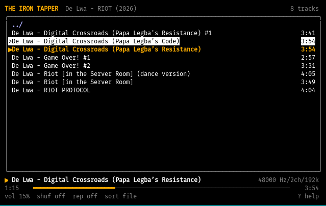

# The Iron Tapper

"music player doing left"

* omnia mea mecum porto - I carry everything mine with me.
* 画蛇添足 - don't draw legs on a snake
* UTF-8 for both filenames and id3v1/id3v2 tags
* Fresh modern TUI
* minimal external libraries dependencies
* playlists support
* playlist control: shuffle, ordered by Artist, Track name, Number, Album, reversed play
* `playmp3list-0.99a` ideas and interface layout inspirations, but fresh and modern-looking
* most system code is inherited from single-header and statically linked libraries
* multiplatform: Linux (main goal), NetBSD, OpenBSD, FreeBSD, Haiku
* Build system: suckless Makefile/config.mk one set for all systems
* Static build when it possible

The Iron Tapper is a small local audio player for the terminal. The filesystem
is the playlist: start in a directory, walk into subdirectories, select a track.
There is no library database, no scanning daemon, no collection and no network
requirement.



More screenshots: [screenshots/](screenshots/).

## Status

MVP; Linux, NetBSD, OpenBSD, FreeBSD and Haiku build and pass the tests;
macOS is expected to build but is untested. It is intentionally small:

* local MP3, WAV, FLAC, Ogg/Vorbis, AAC (ADTS), M4A/AAC and MOD playback;
* `minimp3_ex` for MP3, miniaudio for WAV/FLAC, `stb_vorbis` for Vorbis,
  `miniaac` for AAC, `minimp4` for the M4A container, `pocketmod` for MOD;
* file/directory/playlist arguments;
* m3u, m3u8 and pls import;
* ID3v1 and ID3v2.2/2.3/2.4 tags, including UTF-16 and legacy CP1251;
* directory browser where the current directory is the play queue;
* shuffle, repeat, artist/title/album/track sort, reverse order;
* remove a track from the in-memory list (the file is never touched);
* software output volume — no system mixer;
* a static set of color themes mirrored from the st config, with a terminal
  default that keeps the terminal's own background;
* null audio backend for testing.

Not in this MVP:

* Opus, ALAC, WMA and other codecs; AAC is supported in ADTS `.aac` and
  M4A (AAC-LC); video MP4 is not supported;
* XM, S3M, IT and other tracker formats; MOD is the only module format;
* URL streaming (URL entries from playlists are displayed but not played yet);
* CUE sheets and splitting monolithic album files into tracks;
* saving/exporting playlists;
* cover art, visualizer, library database, mouse, plugins, MPRIS;
* runtime key bindings (keys are fixed for now);
* fully static builds;
* Haiku audio uses a small Media Kit (`BSoundPlayer`) backend and falls
  back to the null device when the Media Kit has no audio output, e.g. in a
  VM without a sound device. It is built but not verified on real Haiku
  audio hardware here.

## Build

Requirements: a C11 compiler, `make`, and the usual POSIX headers. No ncurses,
no libmpg123, no libasound development package: `miniaudio` loads the audio
backend at runtime. This includes macOS: use the system `make` (GNU make
3.81) and clang from the Xcode command line tools; CoreAudio is loaded at
runtime, so no `-framework` flags are needed.

```sh
make
./tit [path ...]
```

`config.mk` holds an optional `PREFIX`, `CC` and `OPT` (`-O2 -g` by
default). With an empty `PREFIX`, `make install` uses `/usr/local`, or
`$HOME/config/non-packaged` on Haiku; override it with `make PREFIX=...`.
For a release build: `make clean && make OPT='-O2'`.

Install:

```sh
make install          # /usr/local, or ~/config/non-packaged on Haiku
make install PREFIX=$HOME/.local
```

The binary is `tit`. `path` may be an audio file, a directory, or an `.m3u`,
`.m3u8`, `.pls`, `.lst` or `.list` playlist. With no path, the current
directory is opened. Several audio file arguments become a selection queue.

Audio extensions: `.mp3`, `.wav`, `.flac`, `.ogg`, `.oga`, `.aac` (ADTS),
`.m4a` (AAC-LC), `.mod` (ProTracker).

Examples:

```sh
./tit                         # browse current directory
./tit ~/Music                 # browse a directory
./tit album.m3u8              # load a playlist and play its first track
./tit song.mp3 more.mp3       # play these files, then next/prev through them
./tit track.flac set.ogg      # formats can be mixed in one queue
./tit --no-audio ~/Music      # no sound device needed (UI testing)
./tit --tag-encoding=cp1251 ~/Music   # old Russian tags
./tit --tag-encoding=utf8 ~/Music     # UTF-8 ID3v1/v2.3 tags
./tit --theme=gruvbox ~/Music         # static color theme
./tit --theme=list                    # list themes
./tit --frame ~/Music                 # frame around the list
./tit -a ~/Music                      # ASCII line drawing (--stickchars)
```

`NO_COLOR=1` disables colors. The UI uses 256-color mode when available.

## Keys

| Key | Action |
|---|---|
| `j` / `k`, Up / Down | move |
| `g` / `G`, Home / End | top / bottom |
| PgUp / PgDn | page |
| Enter | play file, enter directory, load playlist |
| Space | play / pause |
| `n` / `p` | next / previous track |
| Left / Right | seek -5 / +5 seconds |
| `x` | stop |
| `+` / `-` | volume |
| `m` | mute |
| `s` | shuffle |
| `r` | repeat off / all / one |
| `o` | sort: file, artist, title, album, track |
| `O` | reverse order |
| `t` | next color theme |
| `f` | toggle frame around the list |
| `d` | remove highlighted track from the in-memory list |
| `b` / Backspace | parent directory |
| `R` | reload directory / playlist |
| `?` | help |
| `q`, Ctrl-C | quit |

## Notes

* MP3 decoding is `minimp3_ex` (CC0); WAV and FLAC are decoded by `miniaudio`
  (public domain / MIT-0), Vorbis by `stb_vorbis` (public domain), ADTS AAC by
  `miniaac` (0BSD). M4A is demuxed by `minimp4` (public domain / CC0) and its
  AAC samples go through the same `miniaac` decoder (`maac_raw`). Output,
  resampling and software volume are `miniaudio`. Playback does not touch the
  system mixer.
* M4A support is AAC-LC only. ALAC, HE-AAC/SBR and video MP4 are rejected
  with an error. The track is read from the first AAC audio track.
* MOD playback is `pocketmod` (MIT). Classic 15/31-sample ProTracker MOD
  only; XM, S3M and IT are not supported. MOD is rendered as 48 kHz stereo.
  Seeking re-renders the module from the start, so it is approximate.
* ID3 tags are parsed for MP3 only; FLAC/Vorbis/WAV/M4A tags are not shown.
  List durations come from RIFF data size, FLAC STREAMINFO, the last Ogg
  granule, M4A `mvhd`, and the ADTS frame count; MOD durations are computed
  by a low-rate render. ADTS and MOD are the only formats that scan/render
  the whole file for this. Opus (`.opus`, or Opus inside `.ogg`) is not
  supported.
* `--tag-encoding=latin1` is the default per ID3v1/ID3v2.3. Use
  `--tag-encoding=cp1251` for old tags written in CP1251, or
  `--tag-encoding=utf8` for non-standard ID3v1/v2.3 tags written in UTF-8.
* The current directory is the queue. Walking to another directory keeps the
  current playback queue; selecting a track in the new directory makes that
  directory the new queue.
* Every directory view starts with `../`, so the parent directory is always
  visible and selectable. `b` / Backspace go to the parent and keep the
  cursor on the directory (or playlist) you just left.
* Reading a directory or playlist shows `Reading content... Please wait.`
  while it scans tags and durations.
* The header shows the number of playable tracks, not every row. The
  status line after loading also shows the total number of entries
  (directories, playlists and the `../` row included).
* `f` toggles a single-line frame around the playlist/file browser; `--frame`
  enables it at startup. The default is off.
* `d` only removes a row from memory. It never deletes or renames a file.
* URL entries in playlists are visible but marked `[url]`; they are not
  playable yet.
* Color themes are compiled in; there is no theme parser yet. The default is
  `terminal`, which keeps the terminal's foreground/background. `t` cycles
  through the static set; `--theme=NAME` selects one at startup. Themes are
  mirrored from the `st-0.9.3-new-kitty` config (the shared dwm/st/svkbd set):
  `default`, `light`, `plan9`, `dracula`, `solarized`, `nord`, `gruvbox`,
  `cyberpunk`, `ork`, `ledg`, `ledb`, `ledr`, `ledw`, `ledy`, `leda`, `ledc`,
  `ledmg`, plus `Legba` from the old `playmp3listrc`. Truecolor is used when
  `COLORTERM` advertises it; otherwise colors are mapped to the 256-color
  palette. On `vt100`/`vt220`/`vt320`/`wsvt25`/`cons25`/`linux`/`ansi`
  consoles only the 16 ANSI colors are used: those terminals parse `38;5;N`
  as SGR 5 (blink). `TIT_TRUECOLOR=1` forces 24-bit color,
  `TIT_TRUECOLOR=0` forces 256-color mode (and can blink on such consoles).
* Linux, NetBSD, OpenBSD, FreeBSD and Haiku are tested targets (the 2026-11
  codec iteration builds and decodes the same files on all five). macOS is
  expected to build with the same Makefile and uses CoreAudio through
  `miniaudio`, but is not tested here. Audio output uses ALSA on Linux,
  `audio(4)` on NetBSD, sndio/`audio(4)` on OpenBSD, OSS on FreeBSD. Haiku
  uses a Media Kit `BSoundPlayer` backend and falls back to null when no
  output node exists. Static builds are a separate milestone. NetBSD build
  and audio notes are maintained separately.
* FreeBSD base ships termcap, not terminfo, while termbox2 reads terminfo.
  `TERM=xterm` works over ssh; on the native console install a terminfo
  entry or use an xterm-compatible `TERM`.

## Vendored

Pinned copies live in `vendor/`; see `vendor/VENDOR.md`. The project builds
from a fresh checkout without symlinks to an external library store.

## License

MIT. See `LICENSE` and the licenses in `vendor/`.
