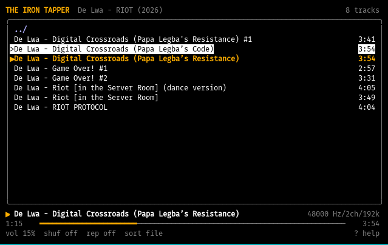
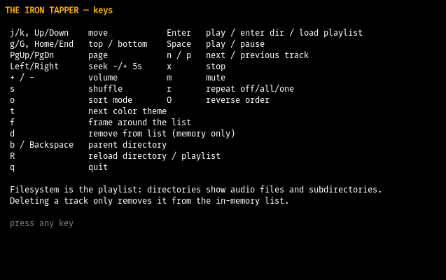
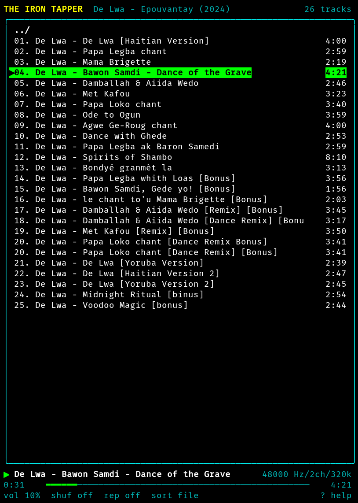
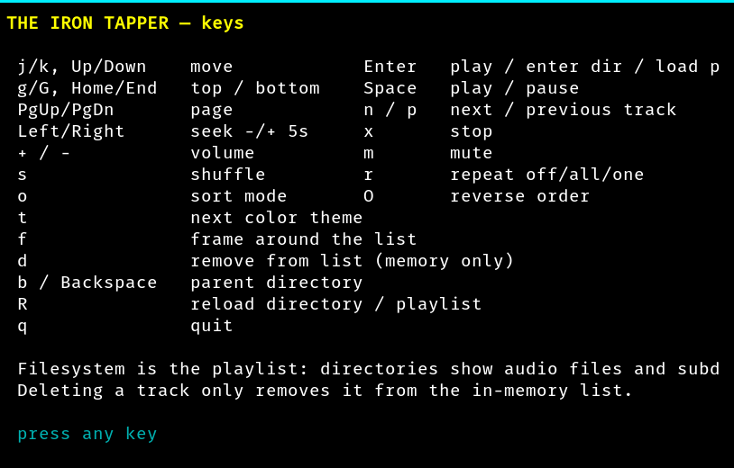
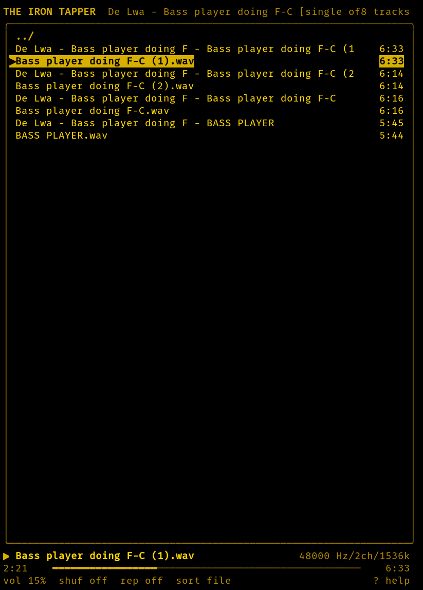
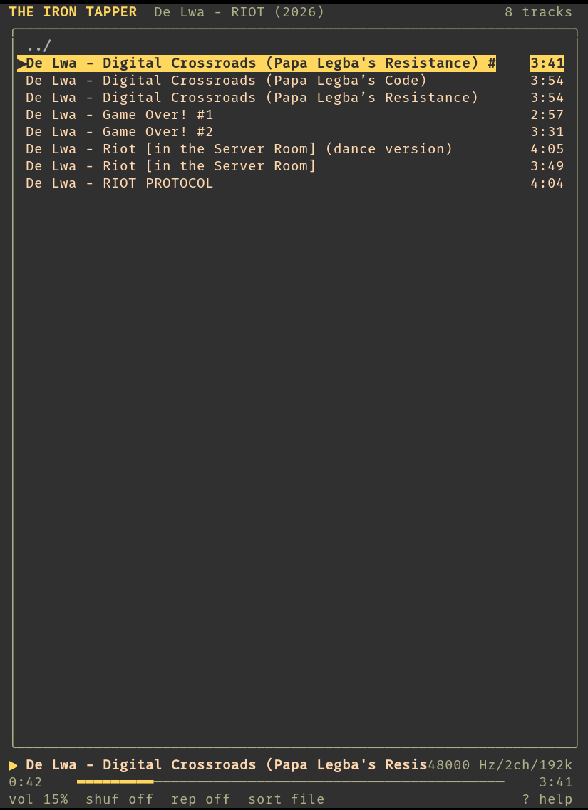
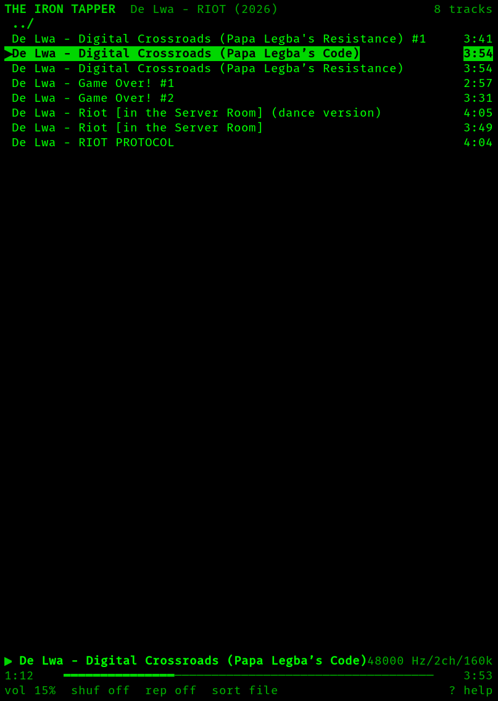

# Screenshots

Terminal captures from a Linux session. The first image is used in the project
[README](../README.md); the rest are kept here for reference.

## Main view

The default look: no frame, the current directory as the queue, the playing
track marked in the list, and the status/progress line at the bottom.

## Key bindings

The `?` help screen.

## Framed album view

A 26-track directory with the frame enabled and a cyan/blue palette.

## Help in a narrow terminal

The help screen at a narrow width; the right column is clipped.

## WAV album

WAV files with long names, framed layout, yellow palette. Durations are read
from the container headers.

## Framed RIOT album

The same 8-track album with the frame enabled and a yellow/olive palette.

## Green theme

The RIOT album with a green monochrome palette and no frame.
